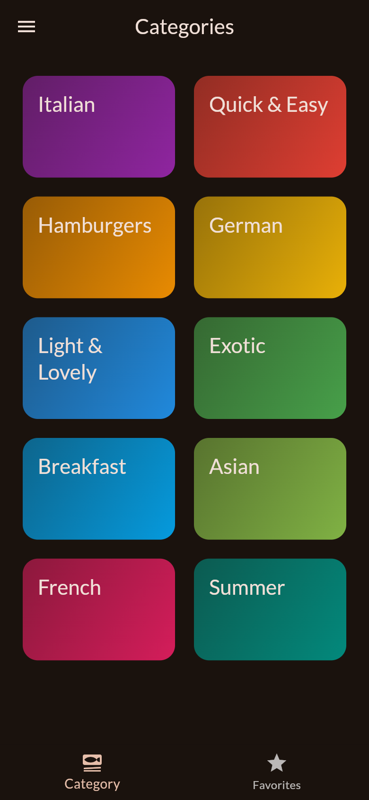
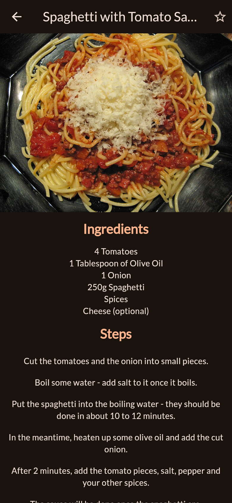

# Meals App

A Flutter recipe app. Browse meals by category, read the ingredients and steps, mark favorites and filter meals by diet.

| Categories | Meals | Meal details |
| ---------- | ----- | ------------ |
|  |  |  |

## Features

- Category grid and meal list per category
- Meal details with ingredients and steps
- Mark and unmark favorites, with a Favorites tab
- Filters from the side drawer: gluten-free, lactose-free, vegetarian, vegan
- Animations: category grid slide-in, favorite icon switch, Hero image transition
- State management with Riverpod
- Works offline with built-in sample data (`lib/data/dummy_data.dart`)

## Getting started

Requirements: Flutter (Dart `>=3.3.4`).

```bash
flutter pub get
flutter run
```

## Project structure

```
lib/
├── main.dart
├── data/dummy_data.dart   # Categories and meals
├── models/                # Category, Meal
├── providers/             # meals, favorites, filters
├── screens/               # tabs, categories, meals, meal details, filters
└── widgets/               # category grid item, meal item, drawer
```

## Commit convention

Commits follow [Conventional Commits](https://www.conventionalcommits.org), checked by `commitlint_cli` through a Husky `commit-msg` hook.
